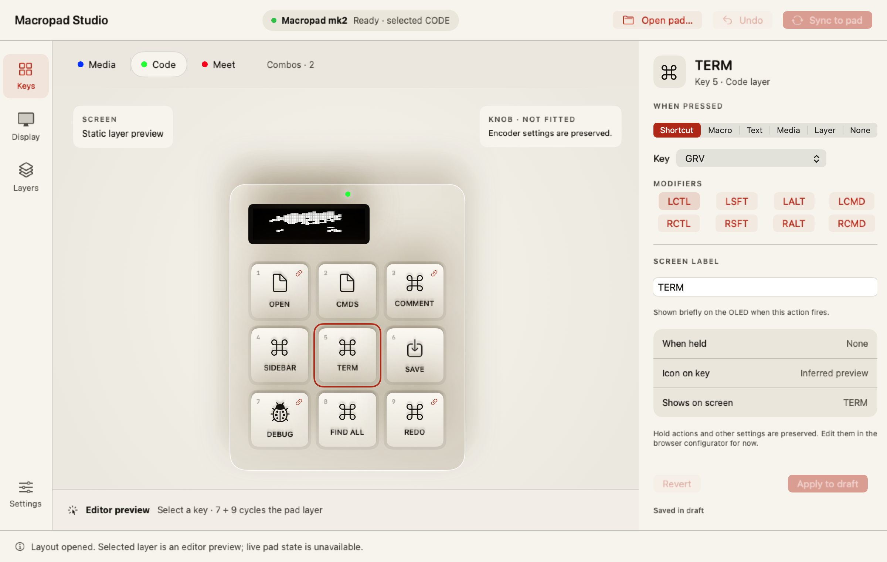
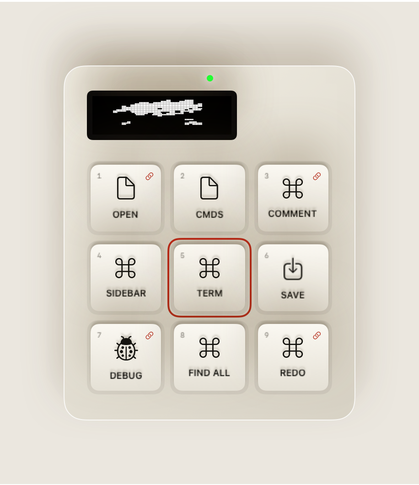
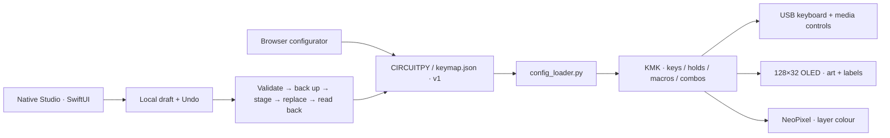

<div align="center">

# Macropad

**Nine keys. Three layers. A little screen with a lot to say.**

XIAO RP2040 · CircuitPython · KMK · Macropad Studio

[Get started](#get-started) · [Native Studio](#macropad-studio--porcelain) · [Architecture](#how-it-works) · [Hardware](#the-pad) · [Plans](plans/README.md)



*The native editor, rendered with this repository’s keymap. Slice 1 is built;
its on-pad checks are pending.*

</div>

## The pad

<table>
<tr>
<td width="38%"></td>
<td>

### Small surface, familiar actions

- **3 × 3 keys** for shortcuts, media, typed text and macros.
- **MEDIA → CODE → MEET**, with a different screen and LED colour per layer.
- **7 + 9 together** cycles layers. **1 + 3** locks the screen.
- **Tap, hold and combos** share the same editable JSON configuration.
- **128 × 32 OLED** for still art and short action labels.

The rotary-encoder headers are routed, but the knob is **not fitted**.
The drawing at left is the app’s device preview, not a hardware photograph.

</td>
</tr>
</table>

## Get started

The browser configurator remains the established tool for the complete current
firmware feature set. Keep `CIRCUITPY` visible while editing.

1. Install the firmware below if the board does not already have it.
2. Open [`configurator/index.html`](configurator/index.html) in Chrome or Edge.
3. Choose **Connect pad…**, then the `CIRCUITPY` folder.
4. Select a key and set a shortcut, media action, typed text, macro, layer action
   or a separate hold action. Configure global combos as needed.
5. Use **Try it** to preview the OLED, LED and actions without sending
   keystrokes to your computer. Number keys 1–9 can test combos.
6. **Save to pad**, then verify the result on the physical keys.

For browsers without direct directory access, export/download `keymap.json`
and copy it to `CIRCUITPY` yourself.

### First-time firmware install

From this repository’s root, with CircuitPython already installed and the board
mounted at `/Volumes/CIRCUITPY`:

```sh
rsync -av code.py config_loader.py macropad_display.py layer_led.py keymap.json kmk lib /Volumes/CIRCUITPY/
```

This explicit file list keeps the native app, documentation and design assets
out of the board’s flash. **Never add `--delete`.** Boot/USB-mode changes belong
to [plan 007](plans/007-boot-config-hide-drive.md), which remains blocked.

For the onboard LED, put `neopixel.mpy` from the
[CircuitPython 10.x library bundle](https://circuitpython.org/libraries) in
`CIRCUITPY/lib/`. The rest of the firmware works without that optional library.

To inspect serial output:

```sh
screen /dev/tty.usbmodem* 115200
```

Exit with `Ctrl-A`, then `K`. A saved configuration is not proof that firmware
reloaded correctly: check for errors and test a key.

## Macropad Studio · Porcelain

A native **macOS 13+** app with an off-white palette, recessed key wells and
an editor built around the pad. The menu-bar item opens Studio when the window
is closed and offers Quit.

| Available in slice 1 | Kept for later slices |
|---|---|
| Open the real keymap and select layers/keys | Live active-layer reporting and menu-bar switching |
| Edit pressed shortcuts, media, text, layer actions and macros | Hold/combo editing, recording and Run in the native app |
| Apply to draft, Revert and Undo | Layer management and templates |
| Validate, back up, stage and sync `keymap.json` | Animation editor and custom OLED playback |
| Preserve existing holds, combos, encoder settings and unknown fields | New firmware/USB protocols |

**Selected layer is an editor preview.** It does not report or change the pad’s
active layer. Use **7 + 9** on the pad. `settings.knob` defaults to false; when
an encoder is fitted later, enable **Knob fitted** in the browser configurator.
Knob press then cycles layers and the explicit 7 + 9 combo remains a backup.

### Build locally

With the installed Xcode/Swift toolchain:

```sh
./studio/scripts/build-app.sh
```

Open `studio/.build/Macropad Studio.app` in Finder. Choose **Open pad…**, edit a
pressed action, **Apply to draft**, then **Sync to pad**. Applied drafts and
prior-file backups stay in local Application Support. The app is a local
development build; no distribution, signing certificate or paid account is
part of this slice.

Read the [Studio guide](studio/README.md) for recovery and checks, and the
[slice review and pad checklist](plans/008-slice-1-review.md) before the first
hardware sync. Host tests do not establish USB/FAT power-loss safety.

## How it works

Both editors use the same version-1 file. Native Studio does not replace the
browser tool or introduce a new firmware format in slice 1.



Sync checks the chosen folder and original file before replacement. Conflicting
external edits block writes. If the pad disappears after replacement starts,
the result is **unknown** until the same pad is inspected again. Nothing
silently retries a write. Backups and drafts are retained on the Mac.

The [format contract](configurator/FORMAT.md),
[approved architecture](plans/008-architecture.md) and
[design inventory](plans/008-inventory.md) document the boundaries and next slices.

## Wiring

Seeed XIAO RP2040, CircuitPython 10.0.0. All 11 exposed GPIO pins are routed;
additional peripherals would need to share I2C or require a separate hardware plan.

| Function | Pins / details |
|---|---|
| Matrix columns | D0, D2, D9 |
| Matrix rows | D1, D3, D8 · COL2ROW diodes |
| Encoder headers, not fitted | A D10 · B D7 · button D6 |
| SSD1306 OLED | SDA D4 · SCL D5 · address `0x3C` · 400 kHz |
| Onboard NeoPixel | `board.NEOPIXEL` / GPIO12; power GPIO11 |

Positions 1–9 match the keys that typed `1`–`9` in the original firmware.

## Around the repository

| Path | Purpose |
|---|---|
| [`code.py`](code.py) | Matrix wiring, module setup and configuration loading |
| [`config_loader.py`](config_loader.py) | JSON → KMK actions, with a fallback media layout on errors |
| [`macropad_display.py`](macropad_display.py) | Per-layer static art, wake behaviour and text toasts |
| [`layer_led.py`](layer_led.py) | Optional onboard layer-colour indicator |
| [`keymap.json`](keymap.json) | Current three-layer layout |
| [`configurator/`](configurator/) | Browser editor and shared file-format documentation |
| [`studio/`](studio/) | Native Porcelain editor and mock-pad tests |
| [`plans/`](plans/README.md) | Status, design decisions and remaining device checks |

### Local KMK patch

`kmk/extensions/display/ssd1306.py` imports `I2CDisplayBus` from `i2cdisplaybus`,
because CircuitPython 10 removed `displayio.I2CDisplay`. Reapply the patch after
updating vendored KMK. The unpatched `sh1106.py` is unused on this pad.

### Rescue

If the drive disappears or firmware misbehaves, enter CircuitPython safe mode:
press reset while the LED blinks just after plugging in. Safe mode skips
`boot.py` and `code.py` and keeps the drive available. If needed, hold BOOT while
plugging in to reach the `RPI-RP2` bootloader and reflash CircuitPython.

The pre-configurator `code.py` is preserved at Git tag `baseline-2026-11-14`.
Recover a prior file deliberately after reviewing the diff; keep a copy of your
current layout before replacing it.

## Licences

- [`kmk/`](kmk/) is vendored from [KMK firmware](https://github.com/KMKfw/kmk_firmware)
  under GPLv3. See [`kmk/LICENSE.md`](kmk/LICENSE.md).
- The compiled Adafruit libraries in `lib/` are released by Adafruit under MIT.
  See the [CircuitPython library bundle](https://circuitpython.org/libraries).
- The firmware glue, Studio, plans and mockups have no licence chosen yet;
  all rights are reserved by the author.
