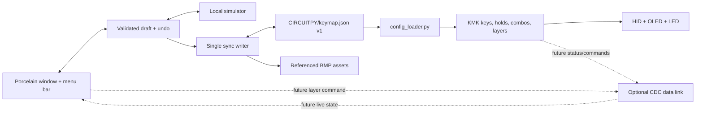

# Macropad Studio · Porcelain architecture proposal

| Approval field | Value |
|---|---|
| Proposal | Plan 008 Step 2 · revision 1 · 2026-11-22 |
| Status | **PROPOSED — awaiting owner approval; Step 3 prohibited** |
| Approved by / date | Pending / not recorded |
| Approved SHA-256 | Pending; no approval is inferred from this document |
| Visual baseline | `design-mockups/porcelain.html`, SHA-256 `8d0638106955c8cb16c39a4ddbca5654a3f03890f31adfe63d3e9b1f33d3e413` |
| Contract baseline | `469014d` on `main`, including merged plan 009 |
| Inventory | [008-inventory.md](008-inventory.md), revision 1; browser visual verification outstanding |
| Requested decision | Approve the stack, first slice, staged fidelity and later-slice boundaries below, or request revisions |

On approval, record the owner's written instruction, date and the SHA-256 of
the reviewed file revision in this table. Preserve that reviewed revision in
Git: annotating approval changes the file's own hash. The approval refers to
the reviewed bytes, not a self-referential hash of the annotation. Material
changes require a new reviewed revision. This proposal does not approve
distribution, spending, hardware changes or plan 007.

## Outcome and current limits

Build a native Mac editor that follows the approved Porcelain layout and can
edit the pad's real configuration safely. Keep the browser configurator usable
throughout. “Macropad mk2” is a label only. The knob remains absent;
`settings.knob` and 7+9 cycling from plan 009 are mandatory compatibility cases.

Today the contract is version-1 `keymap.json`: 1–8 layers, nine actions per
layer, encoder actions, global combos, timing/display/LED settings and static
128×32 one-bit BMPs. `config_loader.py` builds KMK keys; display and LED observe
the current active layer. It does not validate the root version field today;
the new app must validate it itself and must not treat unknown versions as v1.
There is no live host command/status channel, animation playback or physical
test-mode suppression. A mounted drive does not prove firmware loaded a file.

The inventory covers all four mockup screens. The first slice cannot honestly
show live pad state or animate its OLED. Approving this proposal accepts the
explicit staging below; it does not silently accept a redesigned final product.

## Stack options and recommendation

| Option | Native feel | Effort and reuse | Writing CIRCUITPY | Menu bar | Long-term maintenance |
|---|---|---|---|---|---|
| SwiftUI + small AppKit/Foundation adapters | Best fit for native window, focus, menus, accessibility and Mac controls; custom views reproduce Porcelain | Rebuild UI/model; reuse format, fixtures, action semantics and reviewed design tokens, not the monolithic HTML | User chooses drive root; a serialised Foundation file adapter validates, stages and replaces files | `MenuBarExtra` with window-style popover | One app language and Apple APIs; maintain a small pixel editor and device adapter; Mac-only by intent |
| Tauri 2 + web UI + Rust file service | Native shell/tray, web-rendered content; matching Mac control behaviour needs deliberate work | Reuse simulator/pixel routines after extraction; still rebuild Porcelain UI and separate current global DOM state | Rust commands or filesystem plugin restricted to chosen root; same transaction requirements | Native tray API with a custom webview popover for rich content | Rust + JavaScript/CSS and dependency/capability updates; attractive if web reuse/cross-platform needs become priorities |

**Recommend SwiftUI**, with `MenuBarExtra` and Foundation for local file access.
This is an engineering judgment based on the approved Mac-only experience,
not a measured delivery-time claim. Apple documents `MenuBarExtra` from macOS
13 and its rich window-style popover. Proposed minimum is macOS 13, subject
to confirming the owner's target Mac before implementation. See
[Apple MenuBarExtra](https://developer.apple.com/documentation/swiftui/menubarextra)
and [window style](https://developer.apple.com/documentation/swiftui/menubarextrastyle/window).

Tauri is viable: its tray API is available from Rust and JavaScript, and its
filesystem plugin exposes file operations with scoped permissions. It is not
a drop-in wrapper around the existing browser app's directory-picker API.
See [Tauri system tray](https://v2.tauri.app/learn/system-tray/) and
[filesystem plugin](https://v2.tauri.app/plugin/file-system/). The native-feel,
effort and maintenance comparisons above are proposal judgments.

No package installation, toolchain change, paid account, certificate or
notarisation is authorised by these steps. Use existing local tools later;
if absent, report the prerequisite. Local development/build/run feasibility
without new certificates or spending must be checked before scaffolding.

## Structure and ownership

Proposed new folder: `studio/`. No changes to `configurator/` in slice 1.
Keep a single in-process owner of the document and of device writes.

| Boundary | Owns | Does not own |
|---|---|---|
| Studio app / native scenes | Window, menu popover, settings, shared selection and undo | Firmware execution |
| Keymap document | Original JSON, typed known fields, preserved unknown fields, draft, saved baseline fingerprint, validation, layer-reference remapping | Device paths or UI rendering |
| Preview engine | Deterministic actions, holds, combos, active preview layer, output log | Sending HID or pretending to observe physical input |
| Pad store | User-selected root, mount lifecycle, serialised read/sync, hashes, backup and recovery receipt | Editing actions or choosing firmware semantics |
| Pixel asset model | 128×32 bitmaps, frame timeline, authoring metadata, preview/export | Display scheduling on the board |
| Future runtime link | Bounded status/layer/test messages and reconnection | Arbitrary Python execution, shell commands or general file writes |

Native views consume the same document/connection state. Do not create a
second menu-bar copy of the keymap. Preserve unknown JSON properties instead
of losing them through a narrow decoder. Reuse browser behavioural fixtures
and the existing host loader adapter as independent contract checks.

## Data flow

Opening reads the actual file and assets, validates them and stores its exact
bytes as the conflict baseline. Editing changes only the local draft. Sync
serialises to the same v1 contract. The board reloads its config through the
existing firmware path; reading back matching bytes confirms a file save,
not a successful firmware boot or a working physical key.

CircuitPython exposes CIRCUITPY as host-writable USB mass storage; filesystem
ownership and workflows must be respected. An optional second CDC data
interface exists, but this project has not enabled a runtime protocol on it.
See [CircuitPython USB workflows](https://docs.circuitpython.org/en/latest/docs/workflows.html#usb).

## Sync to pad and failure recovery

Slice 1 changes only an action in the existing keymap; it does not upload new
images or firmware. The later asset slice extends the transaction as follows.

1. User explicitly chooses a mounted pad root. Verify the selected folder,
   expected firmware/config files, writable status and available space. Never
   trust the volume label alone or write to the first volume named CIRCUITPY.
   Reconnection requires revalidation; no automatic replay of a pending write.
2. Validate the entire candidate: format version, layer/key bounds, action and
   modifier names, holds, combo coordinates, numeric references, settings and
   all asset paths. Paths must stay within the chosen root; reject traversal,
   escaping symlinks and unsupported action types. Leave existing files alone
   when validation fails.
3. Compare current file bytes with the baseline fingerprint immediately before
   writing. If changed by browser/Finder/another app, stop and offer reload or
   an explicitly reviewed merge. Do not overwrite an external edit silently.
   This detects conflicts; it is not a cross-process filesystem lock.
4. Save the prior config bytes, identity of the selected volume and transaction
   ID in local app recovery storage. Proposed future destination:
   `~/Library/Application Support/Macropad Studio/`; no such directory is
   created by this documentation task. Keep drafts/backup data on the Mac.
5. For later asset sync, write new assets under unique immutable names first;
   close and read back each one, checking size/digest and BMP validity. Never
   overwrite an image referenced by the current config. Do not delete old
   assets in the sync operation. Display accurate encoded size/free space.
6. Write complete JSON to a unique sibling staging file on the same volume;
   close/flush where supported, reopen, parse, and compare its digest with the
   intended bytes. Recheck mounted volume and external-change fingerprint.
   Replace `keymap.json` by a same-volume rename/replacement operation **only
   after** validating that operation on the actual CIRCUITPY filesystem.
   Never implement replacement by truncating/unlinking the live file first.
7. Read the final path back and compare bytes. Mark the draft saved only after
   a match. Show “Saved to pad; firmware reload not verified” until an owner
   test or future runtime acknowledgement establishes more. Local preview
   success never becomes device success.

Temporary-file replacement reduces exposure to partial JSON; it does not
make FAT or USB flash power-loss safe. Host filesystem caching, CircuitPython
auto-reload on filesystem activity and rename/replacement support remain
hardware test obligations. Staging files can trigger reload while the old
valid config is still present. Slice 1 must keep that config usable; later
multi-file updates commit JSON last. Do not assume host “atomic write” flags
prove device durability.

If unplugged before replacement, preserve the draft and Mac backup; the
previous config should remain, and a partial staging file may remain. If
unplugged during replacement/readback, mark the outcome **unknown**, not
failed/saved. On reconnect, revalidate the selected pad, read current bytes,
then classify old / new / invalid / unexpected. New valid bytes need no
duplicate write; old valid bytes allow a reviewed retry. Invalid bytes trigger
the plan's STOP condition: restore the known prior bytes with owner oversight
from the saved/Git baseline, report the failure, and do not continue tests.
Never restore blindly onto a different volume. No auto-cleanup of uncertain
files and no blanket rsync/delete operation.

Initial states: no pad selected, opening, ready, dirty, invalid, externally
changed, syncing, saved, disconnected and sync-unknown. Retain the draft on
disconnect; disable Sync unless the selected destination is valid. Permission
or full-drive errors leave the prior file intact and visible to the user.
Closing the window leaves the menu item running; Quit resolves dirty drafts
and an active/uncertain transaction explicitly. No background sync by default.

## Format evolution and compatibility

**Slice 1: no format change.** Emit `version: 1`, preserve `settings.knob`,
encoder actions, both current combos and all supported fields. No sample
Porcelain layers/macros replace real configuration. Missing knob means false.
Unknown root version means inspect/read-only, never coerce and overwrite.

Later additions below are proposed, not fields to write now. In each affected
slice, document the accepted fields in `configurator/FORMAT.md` alongside app
and firmware changes. Keep v1 behaviour complete even when extensions are
ignored; optional extension subformats carry their own version.

| Addition | Proposed shape | Current-firmware behaviour / rollout |
|---|---|---|
| Key icons | Optional action `studio: {version: 1, icon: "pull-request"}`; stable bundled icon identifiers | Loader ignores extra properties. Icons affect app drawings only; never imply physical key displays. Missing metadata uses an inferred/default icon. |
| Template provenance, disabled layers, editable animation sources | Local Studio project, `version: 1`, containing source assets and stable layer IDs | Do not export disabled layers as a fake firmware `enabled` field. Export only enabled layers, remapping every numeric reference; block dangling references or zero enabled layers. Preserve export ordering/IDs in local project. |
| Layer animation | Optional layer `display: {version: 1, frames: ["lib/studio/<id>-0.bmp", ...], frame_ms: 100, loop: true}` plus existing `.image` pointing to a valid still fallback | Old firmware ignores `display` and shows `.image`. New display module consumes frames only after validation; no required migration to load legacy files. Version-1 examples do not promise 12 fps is safe. |
| Custom key pop-ups | Optional action `display` using the same versioned asset binding, while retaining `.label` | Old firmware uses text label; new firmware adds image/animation handling with clear overlay precedence and timeout. |
| Sleep screen and separate layer-toast settings | Optional `settings.display: {version: 1, ...}` for idle asset and independent toast settings | Old firmware keeps `dim_s/off_s/toast_ms`. Defaults in new firmware reproduce old behaviour when absent. Exact fields finalised in its slice. |

Animation memory/time limits must be established on this board before accepting
assets for device playback: 128×32 one-bit is 512 raw pixel bytes per frame,
excluding BMP headers and Python/display object overhead. Begin with an eight
frame test asset, stream/preload only within a measured budget, and keep the
still fallback. Reject malformed dimensions, frame counts and unsupported
extension versions; fall back to still images without breaking keys. Do not
infer safe RAM use or frame rate from the mockup's free-flash counter.

The browser can read the v1 action/image subset throughout. Its editor may
replace an action and discard optional icon/display metadata. Promise behaviour
compatibility, not lossless rich-project editing by the older tool: retain the
Studio project, warn about lossy export and reimport external files explicitly.
Keep old assets while either tool references them. A future mandatory format
version would require its own migration proposal; this proposal does not need
one and must not break existing files.

## Ordered slices and acceptance evidence

Each slice ends in a reviewable commit, visual comparison against Porcelain,
separate review pass and the plan's human device checklist where applicable.
Do not start any slice until this proposal is approved. No slice auto-approves
new permissions, a changed design or a paid/distribution step.

| Slice | Deliverable and firmware scope | Verification without pad | Device / acceptance gate |
|---|---|---|---|
| 1. Real key edit and sync | Native Porcelain Keys window; open chosen folder; real layers/keys; edit one When pressed shortcut/media/text/layer/macro through minimal complete controls; preserve holds/combos/settings; Undo and safe sync. Menu item opens Studio/quits. No firmware change. Other destinations identify that they are not delivered yet. | Existing and missing-knob v1 fixtures; exact preservation of untouched JSON; edit/export/reimport in browser; load emitted config through real-KMK host adapter. Temporary mock-volume tests inject disconnect/failure at each file boundary, read-only/full destination, stale hash and duplicate sync. UI tests for keyboard/focus/undo and dirty-state retention; side-by-side screenshot with approved Keys screen. | Confirm no certificate/spend prerequisite. Owner accepts staged status text/unfinished destinations. On actual pad verify replacement semantics, reload, edited action, 7+9 cycle and no config errors. Stop on corruption. The Step 5 “current layer” claim is deferred until slice 5; slice 1 labels editor selection honestly. |
| 2. Complete key and combo workflows | Holds, full step editor/recording, local Run/test preview, combo editing, knob settings; native interface over existing actions. No firmware change. | Deterministic clock tests for taps/holds, combo plus individual 7/9, next/prev from all layers; all macro step types round-trip. Record only while focused and explicitly active. Preview never sends actual keystrokes. | Owner tests holds/macros/combos on pad and compares output. Plans 003–006 checks remain separate until observed. |
| 3. Layer management and static display assets | Layer cards, import/duplicate/reorder/templates, local disabled layers, icon metadata, static bitmap tools/import and library; safe assets-first sync. No firmware change for host icons/stills. | Reorder/remap every target context; duplicate IDs/import errors; 1–8 layers; no dangling references; bitmap validation, safe asset paths, interruption at asset/JSON commit boundaries; image+v1 import in browser. Visual checks for Layers and still Display states. | Real pad shows chosen still, LED/name and intended actions after reordering. Owner reviews preset contents; mockup catalogue counts never fabricated. |
| 4. Animation and richer OLED behaviour | Frame editor/library/play/onion skin/speed/loop; layer animation, key-pop-up assets and idle screen. Project-local loader/display additions; `code.py` only for new display config wiring if needed. `kmk/` unchanged. | Frame editing/export golden fixtures; versioned extension parsing; old config defaults; firmware state-machine tests for layer change → toast → animation → idle → wake; old-firmware fallback fixtures. Screenshot review of Display screen. | Measure heap/refresh/input responsiveness on board at proposed bounds; compare keys/encoder/combo reliability, dim/off/wake. Owner approves safe limits and actual library. No claim that 12 fps is achievable until tested. |
| 5. Live menu-bar operation | Real active-layer reporting, menu layer switching and optional physical test mode via separately reviewed USB CDC data protocol. Changes to project `boot.py/code.py`, a small runtime module and capability reporting. No new hardware; no console/drive hiding. | Fake serial peer for handshake/version/limits, stale config hash, timeouts, reconnect, duplicate request IDs and malformed messages; native menu lifecycle; preview vs live status labels. USB descriptor change needs explicit slice approval. | User present for boot/descriptor deployment and recovery. Real 7+9/knob changes reflected in menu, host SET_LAYER acknowledged, HID-suppression test verified and safely exited. If channel unavailable, mark live controls unavailable and preserve offline editor. |

For slice 1, minimal complete action editing means no loss of existing action
types on load/save; later polished recording and rich macro/hold controls can
follow. Do not convert an unsupported existing action into `none`. “Other
destinations not delivered” and “selected layer / live state unavailable” are
temporary differences requiring owner acceptance with this proposal.

Slice 5 protocol proposal: a bounded versioned JSON-line handshake reports
capabilities and current config fingerprint; status events carry the actual
layer. SET_LAYER validates an in-range target against that fingerprint and
uses the same KMK layer transition. Request IDs make repeats idempotent;
timeouts leave state unknown until status is queried. Physical test mode is
explicit, visibly indicated, suppresses HID only after acknowledgement and
exits on disconnect/expiry/reboot. No arbitrary eval/REPL injection, filesystem
access or host shell execution. Refine/review USB enablement and protocol
before that slice; architecture approval is not a silent permission expansion.

## Plan 007, rollback and unresolved choices

Plan 007 remains blocked. Sync requires a visible writable CIRCUITPY drive;
slice 5's CDC link is not a filesystem transfer replacement. Do not hide the
drive/console or repurpose console access while implementing Studio. Revisit
007 separately only with an owner-approved editing/rescue workflow; a future
data channel is not sufficient reason to unblock it automatically.

Rollback is available at every slice: keep `configurator/` and the known v1
layout usable, preserve original assets, and keep the previous config before
sync. If a firmware-bearing slice fails, restore the paired prior project
firmware and config under owner supervision. Metadata extensions remain
optional; still images/text remain fallback paths. No vendor-library edits,
enclosure changes, signing, publication or app installation on other Macs.

Approval decisions for the owner:

1. SwiftUI with macOS 13 minimum, subject to target/toolchain confirmation,
   versus Tauri; no new spending/certificates.
2. Slice 1 delivers real v1 editing and file sync first, with selected-editor
   layer and preview labels; true live-state/menu switching arrives in slice 5.
3. Test mode initially means local simulation. Physical input capture/HID
   suppression is a later explicit runtime capability, not macro execution on
   the Mac. Recording is focused and opt-in; no global monitoring permission.
4. Optional v1-compatible metadata and still fallbacks; native animation and
   live USB features remain separately verified later slices.

## Execution record and stop

Owner instruction for this run: execute only Steps 1–2; no code or
`keymap.json` changes; write this proposal, then wait. KAREN OS startup core
`personal-first-1` reported project OK/no warnings; other KAREN documents were
not loaded, per owner direction. Only project reads, documentation writes,
local Git metadata and primary-source documentation lookup were used.

Coordination record: one worker, no delegation; no product clarification was
needed before drafting. The required Git metadata writes use sandbox approval
prompts. Browser connector/native access failures prevented visual inventory
verification; no rendered PASS is claimed. No device writes, installs or paid
calls were performed. External API references above support stack facts, not
authority to implement them. Host/device implementation timings and runtime
capacity were not measured in this documentation run.

Step 1 inventory and Step 2 proposal are prepared. Final verification is scope
and document coverage only; no implementation tests are claimed. Next safe
action is owner review of this exact proposal revision and hash, plus browser
visual inventory confirmation when available. **Stop before Step 3.**
